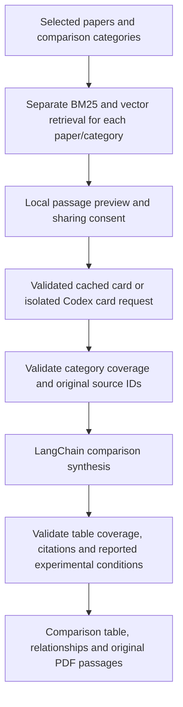

# Domain-Specific RAG Chatbot Using Large Language Models

A local research assistant for AI and Computer Science papers. **Phase 4 adds
paper-balanced comparisons, validated evidence cards and comparison tables** to
the existing PDF library, hybrid retrieval and cited chat. Comprehensive recovery
and quality evaluation remain in their approved later phases.

The approved architecture is unchanged. Generation remains **GPT-6.1 Sol
(`gpt-6.1-sol`) through signed-in Codex and the official Python SDK**. Uploading,
indexing and retrieval stay local. Generation sends the question and bounded
retrieved excerpts only when you permit it. There is no provider or API-key fallback.

- [Project progress and approval gates](PROJECT_PROGRESS.md)
- [Approved architecture reference](docs/ARCHITECTURE.md)
- [Phase 1 verification evidence](reports/PHASE1_REPORT.md)
- [Phase 2 implementation and validation](reports/PHASE2_REPORT.md)
- [Phase 3 implementation and validation](reports/PHASE3_REPORT.md)
- [Phase 4 implementation and validation](reports/PHASE4_REPORT.md)
- [Git workflow](docs/GIT_WORKFLOW.md)

## Run the application

From this repository directory, using its existing environment:

```bash
.venv/bin/python -m streamlit run app.py --server.address 127.0.0.1
```

Open the local URL shown in the terminal. Upload selectable-text English research
PDFs, click **Index uploaded papers**, and inspect the extracted and cleaned page
text. Select the papers you want to question. Confirm deletion to
remove a paper's PDF, catalog pages/chunks, Chroma vectors, and BM25 entries.
Close the app and restart with the same data folder to reopen the library.

To ask a question:

1. Select one or more indexed papers.
2. Enter a question in the chat box. Hybrid search runs locally and shows the
   retrieved passages; no Codex account is needed for this step.
3. To generate an answer, enable the excerpt-sharing checkbox and click
   **Generate cited answer**. The app uses only the approved signed-in Codex route.
4. Inspect each claim's source IDs and the **Validated citations** panel for the
   paper name, PDF page and canonical supporting passage.

Paper selection or corpus changes clear in-memory chat/evidence and reset consent.
The last six question contexts are kept in the current Streamlit session; answers
are not stored in SQLite. Ambiguous follow-ups need a named paper/method or a recent
user question. Earlier assistant answers are never used as documentary evidence.

To compare papers:

1. Select **2–12 indexed papers** and scroll to **Compare selected papers**.
2. Optionally enter a comparison focus and select categories: methodology,
   datasets, results, conclusions and limitations.
3. Click **Collect comparison evidence**. This searches each paper/category
   independently and previews the passages locally; it makes no model request.
4. Enable the comparison excerpt-sharing checkbox, then **Generate comparison**.
   The app validates one evidence card per uncached paper before synthesis.
5. Inspect the table, supported agreements/disagreements, reported experimental
   conditions, and original **Comparison source passages**.

Missing categories are labeled as gaps in the retrieved passages. Failed model
requests are shown as failures, not missing paper content. **Retry failed comparison
requests** reuses valid cached cards. Changing the focus, categories, selection
or corpus clears the preview/result and resets comparison consent. Restart the
app after updating to Phase 4 so its additive SQLite cache table is created;
existing PDFs and vector indexes do not need rebuilding.

A library accepts **1–12 papers**, at most **25 MB and 200 pages per PDF**. Six to
twelve is the intended research workload; a single paper is enough to start.
Identical PDF bytes are detected even if the filename changes, without parsing
or embedding again. Different byte versions are treated as separate papers.

The first indexing operation downloads the pinned public
`sentence-transformers/all-MiniLM-L6-v2` model, approximately 90 MB of weights.
No Hugging Face API key is required for this public model. Embeddings run on the
local CPU; model assets are cached in `data/models`. Downloads need internet and
may encounter public-host rate limits. After caching, local indexing can run
offline. Opening, deleting, or reopening already indexed papers never loads the
embedding model. The dependency environment itself is substantially larger than
the model; allow several GB of disk space.

The optional exported variable `RAG_DATA_DIR` selects another local data folder.
It defaults to this source checkout's `data/` when run as above. `.env.example`
documents settings; no dotenv loader reads `.env` automatically. Use an ignored
or outside-repository folder if overriding the default.

In restricted desktop sandboxes, Hugging Face's Xet downloader may need its cache
redirected into an allowed folder before the process starts:

```bash
HF_XET_CACHE="$PWD/data/models/xet" .venv/bin/python -m streamlit run app.py
```

This changes only a local download-cache location, not the model or sign-in.

## Set up a fresh environment

Use Python 3.11+; this combination was tested with **Python 3.12.14 on Apple
Silicon**. The system Python on the development machine is older and was not
modified. For example, with Python 3.12 installed:

```bash
python3.12 -m venv .venv
.venv/bin/python -m pip install --no-cache-dir -r requirements-phase2.lock
.venv/bin/python -m pip install --no-deps .
.venv/bin/python -m pip check
.venv/bin/python -m pytest -q
.venv/bin/python -m streamlit run app.py
```

`pyproject.toml` pins direct dependencies. `requirements-phase2.lock` records the
complete tested environment; `requirements-phase1.lock` is retained as the
historical Phase 1 snapshot. Phases 3 and 4 use the same installed dependency versions;
the existing LangSmith dependency is now explicitly pinned for disabling tracing.
No new third-party package or model was installed for Phases 3 or 4. Other platforms may require compatible wheels.
The environment and public model cache are not committed. After source edits,
repeat `pip install --no-deps .` with the environment's Python to refresh the
installed verification CLI. Running from the checkout uses its current source.

## How Phase 2 works

```text
Streamlit PDF upload
  → SHA-256 duplicate/capacity checks
  → PyMuPDF reader: one LlamaIndex Document per PDF page
  → original + conservatively cleaned page text in SQLite
  → LlamaIndex SentenceSplitter with MiniLM's tokenizer
  → canonical chunk records and deterministic IDs
  → LlamaIndex HuggingFaceEmbedding / local Sentence Transformers
  → LlamaIndex ChromaVectorStore / persistent local Chroma
  → rank-bm25 snapshot over the same canonical chunks
```

LlamaIndex owns chunking, embedding, and vector writing. It does not create a
second independent corpus or duplicate embeddings. SQLite stores canonical
passages and metadata. Chroma and BM25 share chunk IDs, paper IDs, display titles,
filenames, and one-based PDF page positions. Metadata is excluded from the text
sent to MiniLM. The default 220-token chunks have 40-token overlap and are checked
against the 256-token embedding limit, including special tokens. Vectors have
384 dimensions, are normalized, and use cosine distance.

The exact model revision is
`1110a243fdf4706b3f48f1d95db1a4f5529b4d41`. A configuration fingerprint prevents
mixing vectors with a different model or chunking scheme in an existing library.
Use the original configuration or a new empty data folder; there is no automatic
reindexing or silent model substitution.

A file lock serializes document lifecycle operations. Processing/deleting states
hide incomplete papers. Failed ingestion removes partial records/vectors; startup
retries cleanup of interrupted operations. BM25 snapshots are saved atomically
and restored on restart; missing, corrupt, or stale snapshots are rebuilt from
SQLite without re-embedding. Only load snapshots created by this application;
Joblib is not a safe format for importing untrusted files.

## How Phase 3 works

```text
Question + selected active papers
  → bounded question processing (recent user question for simple follow-ups)
  → selected-paper BM25 + local MiniLM query embedding / Chroma search
  → equal-weight RRF, deduplication and bounded context
  → canonical chunks as LangChain Documents
  → local passage preview
  → explicit excerpt-sharing consent
  → LangChain prompt → isolated Codex gateway → structured claims/source IDs
  → schema + canonical citation checks → answer/source display
```

Both retrieval methods filter before top-K ranking. Defaults are 20 candidates
per method, rank constant 60, and at most eight context chunks/16,000 passage
characters. Ranks start at one; a missing candidate contributes zero. RRF scores
are ranking signals, never answer-confidence percentages. Same-page exact or
subsumed passages are removed conservatively; similar passages with different
experimental numbers are retained. Overlong dense questions are rejected before
MiniLM can silently truncate them. BM25-only and vector-only modes are available
programmatically for later evaluation; the chat uses hybrid search.

LangChain runnable composition connects retrieval, prompt construction, the
existing Codex generation boundary and source validation. LlamaIndex still owns
ingestion/indexing; querying does not rebuild the corpus or create another store.
BM25 refreshes its loaded snapshot after corpus changes. Citation validation uses
only retrieved, selected, still-active canonical chunks. Model-written filenames,
pages or quotations are never trusted. One schema/source-ID repair is permitted;
an unresolved answer is withheld. SDK failures are not automatically retried with
another model. Missing passages/evidence produce an explicit acknowledgment.

The stricter `EvidenceGateway` reuses Phase 1 authentication, exact-model checks,
turn handling and timeout/cancellation. Each request discovers configuration with
no model turn, disables inherited MCP servers/plugins/skills, and then audits the
effective configuration. The answer thread uses a restricted read-only profile
limited to its temporary directory and platform defaults, with tool network access
disabled. Hooks, notifications, web/shell/image tools, memory, subagents and
telemetry export are disabled for that worker. Inherited instruction files are
rejected. Service endpoint checks accept only the official OpenAI/ChatGPT hosts.
User configuration and authentication are not edited or copied.

LangChain tracing is also disabled in the application process around retrieval
and generation, so inherited tracing settings cannot export questions/passages.
The pinned SDK lacks high-level helpers for the needed inspection RPCs; a small
adapter accesses its low-level official SDK client and checks the raw thread
permission response. Incompatible/unverifiable settings disable generation while
retaining local retrieval. Revalidate this boundary before changing SDK versions.

## How Phase 4 works



Each paper/category receives eight sparse and eight dense candidates. The existing
RRF implementation keeps up to two passages per category, with a total per-paper
passage budget of 16,000 characters. One paper cannot consume another's budget.
Source IDs are canonical chunk IDs, stable across paper ordering and cached cards.

One structured card request per paper extracts cited findings. Results can include
reported task, dataset, split, metric, value and settings; absent fields remain
unknown. A second chain selects validated card entries for every table cell and
generates cited relationships. The app renders the selected entry text rather
than accepting independently invented table facts. Every relationship must cite
category evidence from each named paper. All source panels resolve to the original
canonical passages, not an intermediate card.

Result agreements/disagreements require complete matching reported task, dataset,
split, metric and settings. Missing or mismatching fields produce **not directly
comparable** assessments. Matching uses conservative case/whitespace normalization,
not semantic equivalence or unit conversion; matching labels do not establish a
fair scientific experiment. Different numbers or methods are not automatically
contradictions. Source support still requires human/evaluation review.

Validated cards are cached in the existing local SQLite catalog using paper version,
focus, categories, model, card-prompt version, retrieval settings and retrieved
source IDs. Cache reads are revalidated against current canonical records. Invalid
card JSON is regenerated; deleting a paper cascades to its cards. Retention is
bounded to 16 cards per paper. Comparison results remain session-only, and synthesis
runs again even when all cards are cached.

Each card/synthesis request has at most two attempts total: an initial request and
one transient retry or schema/citation repair. Authentication, model or isolation
failures stop further generation. A failed card withholds synthesis until all
selected papers have validated cards; successful cards remain cached for retry.
No new SDK worker, provider, embedding model or vector store is introduced.

## Important files

| File | Purpose |
| --- | --- |
| `app.py`, `.streamlit/config.toml` | Local Streamlit entry point, upload cap, telemetry preference |
| `src/ui/documents.py` | Batch uploads, saved papers, selection, page preview, confirmed deletion |
| `src/config.py` | Separate ingestion, retrieval and fixed-model Codex settings |
| `src/schemas.py` | Canonical source records, structured claims, citations and answer results |
| `src/ingestion/pdf.py`, `cleaning.py` | Page-aware PyMuPDF reader, layout warnings, conservative cleanup |
| `src/ingestion/chunking.py` | Token-aware LlamaIndex chunks and stable IDs |
| `src/embeddings.py` | Lazy CPU MiniLM via LlamaIndex's Sentence Transformers integration |
| `src/ingestion/indexing.py` | The single LlamaIndex-to-Chroma writer |
| `src/ingestion/pipeline.py` | Document lifecycle, duplicate detection, locking, and cleanup |
| `src/persistence.py` | SQLite catalog, canonical chunk lookup and active-corpus version |
| `src/retrieval/bm25.py`, `vector.py`, `hybrid.py` | Sparse/dense filtering, RRF and context selection |
| `src/retrieval/adapters.py` | Actual LangChain Documents and retrieval runnable |
| `src/generation/llm.py`, `src/verification.py` | Preserved Phase 1 gateway/verifier; gateway adds isolation extension hooks |
| `src/generation/isolation.py` | Mandatory worker configuration and thread-permission checks |
| `src/generation/prompts.py`, `chains.py`, `citations.py` | Versioned prompts, orchestration, one repair and canonical citations |
| `src/ui/chat.py` | Local question search, consent, answers and source panels |
| `src/retrieval/comparison.py` | Per-paper/category budgets and comparison evidence snapshots |
| `src/generation/comparison.py` | Card generation/cache reuse, bounded retries and synthesis |
| `src/generation/comparison_validation.py` | Card/table/relationship provenance and experimental-context checks |
| `src/ui/comparison.py` | Local preview, consent, comparison tables, failures and original sources |
| `src/phase3_verification.py` | Explicit isolation/canary and optional live synthetic RAG verifier |
| `src/phase4_verification.py` | Explicit synthetic multi-paper comparison and card-cache verifier |
| `tests/` | Existing regressions plus retrieval, answer, isolation, chat and verifier tests |

Local runtime layout (all ignored):

```text
data/
  catalog.sqlite3
  library.lock
  papers/<sha256>.pdf
  chroma/
  bm25.joblib
  models/
```

## Tests and verification

```bash
.venv/bin/python -m pytest -q
# Include all three real MiniLM integration tests (first use may download public weights):
HF_XET_CACHE="$PWD/data/models/xet" .venv/bin/python -m pytest --run-embedding-integration -q --junitxml=reports/phase4-all-tests.xml
.venv/bin/python -m pip check
```

The standard suite uses synthetic PDFs and deterministic test embeddings while
exercising real PyMuPDF, LlamaIndex, Chroma, BM25, SQLite, Streamlit and LangChain.
No pytest test makes an LLM request. The three real embedding tests are skipped
unless opted in. After public model caching, the full suite can run with
`HF_HUB_OFFLINE=1`. Results and limits are in the [Phase 4 report](reports/PHASE4_REPORT.md).

Latest Phase 4 validation (November 6, 2026): **234 tests passed, none skipped**,
including all 181 existing Phase 1/2/3 tests. Separate live synthetic comparison
verification through the exact signed-in Codex model and the local HTTP smoke
check also passed.

Explicit worker verification (requires signed-in Codex and OS execution permission):

```bash
# Effective settings, temporary thread and synthetic filesystem checks; no model inference:
.venv/bin/python -m src.phase3_verification --report reports/phase3-isolation.json
# Optional synthetic injection, cited RAG answer and missing-evidence checks:
HF_XET_CACHE="$PWD/data/models/xet" .venv/bin/python -m src.phase3_verification --live --report reports/phase3-live.json
```

`rag-verify-rag` is the installed equivalent. `--live` consumes Codex allowance:
normally three turns, up to five if either RAG response requires its one repair.
The filesystem verifier uses `/bin/cat` and has been tested on macOS, not Windows.
It reads only generated control/canary files. JSON/XML reports remain local and ignored.

Explicit Phase 4 verification:

```bash
# Existing isolation checks only; no model inference:
.venv/bin/python -m src.phase4_verification --report reports/phase4-isolation.json
# Generated two-paper comparison, agreements/disagreements, gaps and cached-card reuse:
HF_XET_CACHE="$PWD/data/models/xet" .venv/bin/python -m src.phase4_verification --live --report reports/phase4-live.json
```

`rag-verify-comparison` is the installed equivalent. Its live check normally uses
four model requests, up to eight with bounded retries/repairs. The recorded live
run used four. It submits generated synthetic passages only.

Phase 1's verifier still works:

```bash
.venv/bin/python -m src.verification
# Optional synthetic inference; consumes Codex usage:
.venv/bin/python -m src.verification --live --report reports/phase1-verification.json
```

The default verifier checks account/model metadata without generation. The exact
model is required: no fallback or API-key authentication. Phase 1 previously
verified a live structured LangChain response through the official SDK and
existing ChatGPT-managed Codex sign-in. Phase 3 separately verifies the stricter
evidence worker and synthetic RAG workflow.

## Limits and costs

- Text extraction uses line geometry to improve two-column reading order, but it
  is a heuristic. Check the preview. PDF page positions can differ from printed
  page labels. Scans need OCR and are rejected when there is no usable text;
  sparse/blank pages remain visible with warnings. Figures, equations, complex
  tables, and layout-dependent meaning are not reliably interpreted.
- Source IDs, selected papers, canonical passages and PDF pages are validated.
  This establishes traceability, not semantic support for every claim. Retrieval
  quality, faithfulness and hallucination measurement remain Phase 6; no accuracy
  improvement or general injection immunity is claimed from synthetic checks.
- This is a single-user local app. Document status recovery handles basic partial
  operations; comprehensive corruption/recovery and UI refinement remain Phase 5.
  Deletion removes application data logically, not forensic traces or backups.
- No hosted model fee is incurred by Phase 2. Local tools/model downloads use
  disk, CPU, and internet bandwidth. PyMuPDF's existing AGPL/commercial licensing
  decision remains relevant before distribution; no license choice is changed.
- Phase 3 answer generation uses the account's Codex allowance, including any
  explicit repair. No API credits are assumed or purchased. SDK runtime startup
  can need OS execution permission in the desktop sandbox. Account entitlement,
  quotas and managed restrictions can change; failed isolation checks disable
  generation. The live tests used generated evidence only, not private papers.
- Phase 4 normally uses one card request per uncached paper plus one synthesis
  request. Cached cards save their generation calls; final synthesis still uses
  allowance. Larger comparisons can take longer. Reported-condition matching and
  structural source validation do not replace scientific or faithfulness review.
- Chat history is session-only and cleared when source scope changes. Ambiguous
  follow-ups use a simple bounded rule. Broad PDF quality, adversarial coverage,
  manual browser file-upload transport and other operating systems remain untested.

## Git workflow and stop point

Phases 1, 2 and 3 have been published to
[sumanyuu10/domain-specific-rag-chatbot](https://github.com/sumanyuu10/domain-specific-rag-chatbot).
Phase 4 is completed, tested and reviewed. The user approved its commit and push
on November 6, 2026. Phase 4 commit message:

```text
feat: add phase 4 cited research paper comparisons
```

`.gitignore` excludes `.env` variants, credentials, PDFs/private documents, local
databases/vectors/models, caches, environments, build output, and raw reports.
Only `.env.example`, source, tests, and curated documentation are publishable.
Publication follows the [Git workflow](docs/GIT_WORKFLOW.md); future phase commits
and pushes require their own approval.
**Stop after the authorized Phase 4 publication. Phase 5 has not started and needs
explicit approval.** Its scope is restart/deletion recovery, graceful service/storage
failures, and source/UI refinement; see [the preparation plan](PROJECT_PROGRESS.md#phase-5-preparation--not-implemented).

## Implementation references

- [LlamaIndex ingestion pipeline](https://developers.llamaindex.ai/python/framework/module_guides/loading/ingestion_pipeline/)
- [LlamaIndex Chroma integration](https://github.com/run-llama/llama_index/blob/main/llama-index-integrations/vector_stores/llama-index-vector-stores-chroma/llama_index/vector_stores/chroma/base.py)
- [MiniLM model card](https://huggingface.co/sentence-transformers/all-MiniLM-L6-v2)
- [PyMuPDF extraction](https://pymupdf.readthedocs.io/en/latest/recipes-text.html)
- [Streamlit upload widget](https://docs.streamlit.io/develop/api-reference/widgets/st.file_uploader)
- [Codex SDK](https://learn.chatgpt.com/docs/codex-sdk)
- [Codex configuration reference](https://learn.chatgpt.com/docs/config-file/config-reference)
- [App-server configuration and thread interfaces](https://learn.chatgpt.com/docs/app-server)
