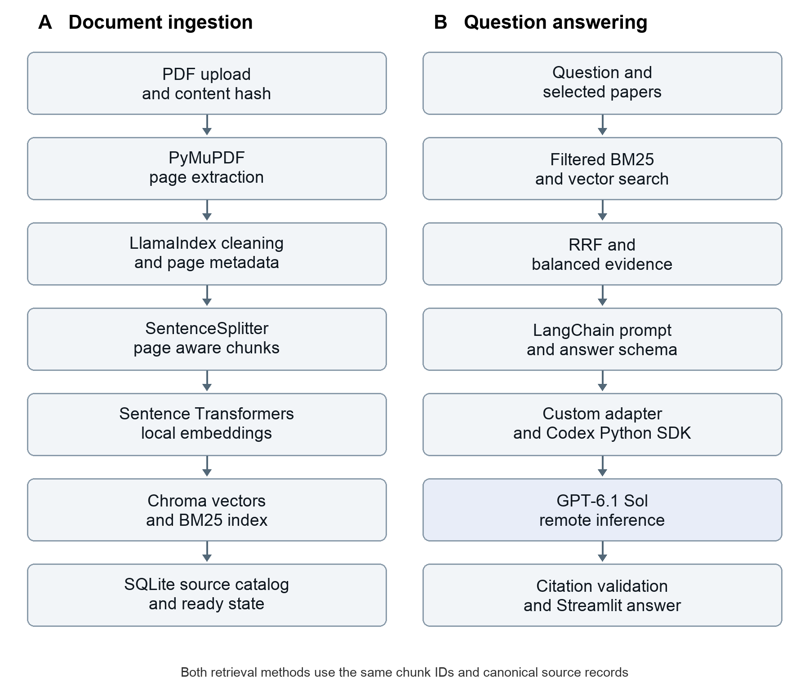

> Approved architecture reference preserved from the existing planning document.
> Historical approval/verification wording describes the planning stage. Phase 1
> was subsequently approved and implemented; current status is maintained in
> [PROJECT_PROGRESS.md](../PROJECT_PROGRESS.md). This copy does not authorize later phases.

# Domain Specific RAG Chatbot Using Large Language Models
## Technical architecture and implementation proposal

Updated November 2 2026 | GPT-6.1 Sol through Codex | Proposed for review

This document defines a local research assistant for students and researchers comparing 6–12 AI and computer science papers. It preserves the resume stack of Python, LangChain, LlamaIndex, ChromaDB, LLMs, embeddings, and BM25, with a distinct purpose for each technology.

The selected generation backend is **GPT-6.1 Sol through Codex**, connected programmatically through the official Codex Python SDK. LangChain will orchestrate retrieval and generation through a small custom adapter. LlamaIndex will own ingestion and vector indexing. PDFs, canonical source passages, embeddings, and indexes remain on the local computer; permitted retrieved excerpts are sent for remote model inference.

The implementation target is 10–14 focused development days with substantial coding assistance. The initial work verifies Codex authentication, model access, structured output, and the shared-index integration before building the full application. No implementation is authorized by this document; coding and installation remain pending explicit approval.

### Intended outcomes
- Ask natural-language questions about uploaded papers and receive evidence-based answers.
- Compare methodologies, datasets, results, conclusions, and limitations across selected papers.
- Identify supported agreements and disagreements while explaining differences in experimental settings.
- Inspect citations containing paper names, one-based PDF page numbers, and stored supporting passages.
- Acknowledge missing evidence and evaluate retrieval quality, faithfulness, citation support, and latency.

### First version boundaries
Support English PDFs with selectable text, one local user, a browser interface, persistent collections, and deletion. Permit up to 12 papers and allow querying one paper or comparing multiple selected papers. Reliable interpretation of scans, figures, mathematical notation, and structured result tables is deferred. Public hosting, authentication systems, Docker, microservices, and automatic web discovery are deferred.

### Meaning of the Codex change
Codex is the programmatic generation route as well as a development assistant. The model identifier is `gpt-6.1-sol`. The local SDK controls a Codex app-server; it does not run the model weights locally. This route uses supported Codex sign-in and the account's model access and usage limits. It does not assume ChatGPT subscription credits are OpenAI API credits. The SDK and authentication surfaces are documented in sources [1] and [2].

Research establishes documented interfaces, not a tested package combination or verified account entitlement. These checks remain the first implementation milestone.

# 1 Recommended technology stack

Use one Python application with one document catalog, one embedding service, and one Chroma database. Most implementation complexity lies in source preservation and the boundaries between components.

| Technology | Concrete responsibility | Limitation and effort |
|---|---|---|
| Python 3.11 | Shared application language and initial compatibility target | Pin the tested package set; low setup effort |
| Streamlit | Uploads, paper selection, chat, comparison tables, sources | Less UI control than a custom frontend; low |
| PyMuPDF | Extract page text and layout blocks locally | Reading order needs inspection; medium |
| LlamaIndex | Documents, metadata, cleaning transformations, chunking, indexing | Configure every embedding and transformation explicitly; medium |
| Sentence Transformers | Local all-MiniLM-L6-v2 embeddings for chunks and questions | Short inputs and generic research vocabulary coverage; low to medium |
| ChromaDB | Persistent vectors, similarity search, metadata filtering, deletion | Synchronize with the catalog; medium |
| rank-bm25 | Sparse keyword scoring over the same chunks as Chroma | Application owns tokenization and snapshots; low |
| Reciprocal Rank Fusion | Merge dense and sparse rankings by chunk ID | Ranking is not calibrated confidence; low |
| LangChain | Retriever adapters, runnable chains, prompts, answer schema | Custom Codex adapter and version compatibility; medium |
| Codex Python SDK | Invoke GPT-6.1 Sol through the local Codex app-server | Sign-in, model availability, quotas, tool controls; medium |
| SQLite and Joblib | Canonical catalog and versioned BM25 snapshot | Recover incomplete operations and reject stale snapshots; low to medium |
| Custom evaluation and optional Ragas | Retrieval metrics, human claim review, optional model judging | Labeling time and optional evaluator usage; medium |

Local library use has no hosted platform fee. Compute, disk storage, and the initial embedding-model download use the local machine and internet connection. PyMuPDF is offered under AGPL and commercial terms; its license must be considered before future distribution [10].

Use `llama-index-core`, `llama-index-vector-stores-chroma`, and `llama-index-embeddings-huggingface` for ingestion, alongside `langchain-core` runnable interfaces for orchestration. Select stable compatible releases and record exact versions after the first round-trip test. Optional provider and Ragas packages should not become mandatory for the core application.

# 2 High level system architecture

The two pipelines share canonical chunks and source metadata. The question pipeline may read the indexes but does not load, split, or embed the uploaded papers again.



The Codex adapter is a local application component. Model inference is remote. No direct Gemini, Groq, or OpenAI paid API integration is required for the selected Codex route.

Comparison questions use a paper-balanced branch: retrieve by paper and category, generate cited evidence cards, validate them, and synthesize a comparison whose citations still resolve to original passages.

# 3 Document ingestion and indexing

### Upload and identification
Streamlit passes the PDF to an ingestion service. Compute a SHA-256 content hash as the stable `paper_id`, detect duplicate bytes, save the file locally, and record a processing state. Treat filenames as display labels. Different versions of the same paper remain separate when their bytes differ.

### Page aware PDF processing
Use a thin LlamaIndex `BaseReader` adapter around PyMuPDF. It produces one LlamaIndex `Document` per page and attaches the paper ID, filename, and one-based PDF page number. Block-based extraction gives the application control over reading order and diagnostics. A built-in LlamaIndex PyMuPDF reader also exists; its current implementation confirms page-level metadata support [3, 9].

Store original extracted page text and cleaned text. Normalize whitespace, preserve technical punctuation and experimental values, and remove only clearly repeated page furniture. Provide an extraction preview so the researcher can inspect two-column pages. Flag suspicious reading order, empty pages, and mixed content. Return actionable errors for corrupt, password-protected, or text-empty files.

PDF page numbers are physical positions in the PDF, beginning at one. They may differ from printed page labels. Bibliographic titles can be extracted heuristically and edited; the filename is the fallback. Do not invoke a hosted LLM merely to create titles or metadata.

### Chunking and local embeddings
Use LlamaIndex `IngestionPipeline` and `SentenceSplitter`, preserving page boundaries and source metadata. Begin with approximately 220 embedding tokens per chunk and 40-token overlap. Count with the MiniLM tokenizer and validate the final input length, including special tokens.

The selected `all-MiniLM-L6-v2` model produces 384-dimensional vectors and truncates text beyond 256 word pieces by default. Large generic RAG chunks would silently lose content during embedding [6]. Configure LlamaIndex `HuggingFaceEmbedding` to use this Sentence Transformers model, CPU execution initially, and normalized vectors [5].

Use the same model, tokenizer, normalization policy, and model revision for document and query embeddings. Exclude filenames, IDs, and administrative metadata from embedded text. Record the configuration fingerprint so incompatible vectors cannot be mixed later.

### Index publication
LlamaIndex `ChromaVectorStore` writes each node ID, explicit embedding, plain passage text, and metadata into one persistent Chroma collection. The integration source confirms these fields are written together [7]. Keep canonical records in SQLite. Build `BM25Okapi` from those exact chunk texts, using identical lexical tokenization for corpus and query [8].

Mark a paper ready only after both retrieval paths are usable. Avoid a separate persisted LlamaIndex transformation cache initially; completed-paper records provide duplicate detection without another source-text copy to delete.

# 4 Framework boundary and query retrieval

### One canonical chunk contract
Derive stable chunk IDs from the paper ID, pipeline version, page number, and chunk ordinal. Store these shared fields in the catalog and propagate them through both retrieval paths.

| Field | Purpose |
|---|---|
| chunk_id | Identity for BM25, vectors, deduplication, and citations |
| paper_id | Paper selection, balanced retrieval, and deletion |
| filename and display_title | Human-readable source labels |
| page_number | One-based physical PDF page |
| text | Canonical cleaned evidence passage |
| chunk_ordinal | Stable order within its source page |
| pipeline_version | Extraction, chunking, and embedding configuration identity |

LlamaIndex owns ingestion, node construction, metadata propagation, and vector indexing. LangChain owns query handling, retrieval composition, prompts, and answers. At query time, a custom LangChain retriever adapter uses explicit query embeddings to read the existing Chroma collection and returns LangChain `Document` objects. It resolves canonical records by chunk ID and does not depend on private LlamaIndex node serialization.

LangChain does not parse or split the PDFs again. There is no second vector database, embedding model, LlamaIndex query engine, or parallel answer generator.

### Question processing and filtering
Accept the question, selected paper IDs, and mode. Normalize whitespace without stripping acronyms, model identifiers, dataset names, or metric names. Resolve simple follow-ups from recent user turns and selected papers; ask for clarification when references are ambiguous. Earlier assistant answers are not documentary evidence.

Apply paper selection before top-K ranking. Chroma uses metadata filters [12]. BM25 restricts eligible chunk positions before selecting results. Keep corpus and query lexical tokenization identical. Rank-BM25 does not preprocess documents automatically [8].

### Hybrid retrieval defaults
For ordinary questions, retrieve 20 candidates per method, fuse by stable chunk ID, remove repeated overlapping evidence, and retain about eight passages. Combine ranks using equal-weight RRF with a rank constant of 60. Ranks begin at one; a missing candidate contributes zero [13]. These are initial settings for evaluation, not an optimality claim.

For a candidate present in both lists, its score is the sum of the reciprocal of 60 plus its BM25 rank and the reciprocal of 60 plus its vector rank. Scores order candidates; they must not be displayed as answer confidence or compared to an invented universal threshold.

# 5 Research paper comparisons

### Collect evidence from every selected paper
For each selected paper, run retrieval independently for methodology, datasets, experimental results, conclusions, and limitations. Start with eight sparse and eight dense candidates per category. Fuse them within that paper, retain up to two per category, and deduplicate repeated chunks.

Paper balance is an explicit retrieval policy, not an incidental result of global search. Each selected paper receives an evidence budget. If a category has no usable supporting evidence, record that gap instead of filling it from another paper.

### Generate and validate evidence cards
Use one bounded Codex generation request per paper to create a structured evidence card. Each factual entry carries original source IDs. Validate those IDs before the card can enter synthesis. Cache cards using paper version, question or category selection, model identifier, and prompt version.

Use a second LangChain chain to synthesize validated cards into a comparison table and an agreement or disagreement summary. Preserve the link from every table cell and synthesis claim to original source passages. The source viewer must not stop at an intermediate generated card.

### Interpret experimental results carefully
Record the dataset, evaluation split, metric, task, and relevant settings when the text provides them. A higher number does not establish a stronger method if experiments use different datasets or protocols. Label these cases as not directly comparable unless the papers support a more specific conclusion.

A disagreement needs evidence from the relevant papers. Missing details or different research questions are not automatically contradictions. Distinguish the authors' stated conclusions from the assistant's comparison of those conclusions.

The first version uses selectable text only. Values located solely in unreadable tables, charts, or equations are unavailable evidence. Acknowledge this limitation in the affected comparison rather than treating missing extraction as proof that the paper omitted the result.

### Runtime behavior
Process evidence cards sequentially initially, show progress per paper, and retry only failed requests within bounded limits. A 12-paper comparison can require 12 card requests plus synthesis and any repair request. It will consume more Codex usage and can take longer than a single chat answer. No response-time guarantee is appropriate before measurement.

Cache reuse reduces repeated inference, but a changed or deleted paper, model, prompt, or extraction configuration invalidates the affected cards. Selection changes must also invalidate any answer whose evidence no longer matches the selected set.

# 6 GPT 6 1 Sol through Codex

### Selected integration
Use the official `openai-codex` Python SDK, with its `openai_codex` import surface, to control a local Codex app-server and request `gpt-6.1-sol`. Current documentation describes a stable Python SDK, Python 3.10 or later, and a pinned Codex runtime in published SDK builds [1]. Keep the project on Python 3.11 as its initial compatibility target.

LangChain calls a custom runnable adapter in `generation/llm.py`. The adapter accepts the prepared prompt and answer schema, starts or uses an isolated generation turn, collects the final response, and translates errors into the application's model-neutral error types. It must not rely on an unverified built-in LangChain Codex chat integration or pass Codex credentials to `ChatOpenAI`.

The generation path is: retrieved evidence → LangChain prompt → custom Codex adapter → local Codex SDK and app-server → remotely hosted GPT-6.1 Sol → structured response → citation validation → Streamlit.

### Authentication and usage
Use supported Codex account sign-in. App-server supports ChatGPT-managed authentication; local applications are distinguished from commercial or hosted services in the documentation [2]. Model availability depends on the signed-in account, client, workspace policy, and service limits [16]. Never copy browser tokens into application code or treat subscription access as an OpenAI API key.

The first integration milestone must complete a real authenticated model turn, verify the selected model, inspect current usage-limit behavior, and verify a structured-response round trip. Opening this desktop chat alone does not establish that the SDK worker is authenticated or authorized.

### Answer worker restrictions
Provide only the question, necessary user conversation context, selected paper labels, and bounded retrieved excerpts. Configure an isolated worker with restricted filesystem permissions and no web, shell, or unrelated document access for answer generation. Verify the available SDK and app-server controls before accepting this boundary; read-only filesystem access alone is not evidence isolation.

Keep application-controlled retrieval as the evidence source. If the worker cannot meet the required restrictions, stop that integration step and report the limitation rather than silently broadening access. The model remains remote even though its controlling process runs locally.

### Generation contract and citation checks
Prompts require claims grounded in supplied excerpts, attached source IDs, acknowledgment of gaps, and separation of paper findings from cross-paper synthesis. Treat instructions embedded in PDF content as untrusted text. Return structured claims and comparison cells rather than trusting free-form citation strings.

Resolve each citation against the current turn's retrieved chunks and selected active papers. Display filenames, PDF page numbers, and excerpts from local storage; never use model-written quotations as source text. Permit one bounded repair for malformed output or invalid source IDs. Withhold unresolved claims and explain the failure. Citation validation proves traceability, not semantic support.

# 7 Persistence errors and document deletion

### Local storage responsibilities
Use Chroma `PersistentClient` for vectors, SQLite for canonical papers, pages, chunks, operation states, and configuration versions, and a versioned Joblib snapshot for BM25 plus its chunk ordering. Chroma supports disk-backed local clients [11]. Streamlit session state and resource caches are for UI continuity and loaded objects, not durable document storage [14].

On normal restart, reopen Chroma and load the compatible BM25 snapshot. Do not parse or embed unchanged PDFs again. Use only application-generated Joblib files; Joblib uses Python serialization and is not a safe exchange format for uploaded index files [15].

When the corpus changes, rebuild the small BM25 index from stored chunks and replace its snapshot atomically. Preserve unaffected document vectors. If a snapshot is missing, corrupt, or version-incompatible, recover the sparse index from the catalog without re-embedding the corpus.

### Configuration changes and interrupted operations
An embedding-model, normalization, cleaning, or chunking change requires an explicit reindex into a collection with matching configuration. Never silently mix embedding spaces or re-use evaluation labels tied to an old chunk layout.

SQLite, Chroma, and files do not share a transaction. Use persistent processing states and a single application lock. Queries include only ready papers. Recover or clean incomplete ingestion and deletion on restart. A failure must not expose a partly indexed collection as complete.

### Deletion sequence
Mark the paper unavailable immediately, obtain its chunk IDs from the catalog, delete those vector records, remove its canonical records and PDF, purge dependent evidence cards and stored answers, update BM25, and invalidate UI caches. Deleting by canonical IDs covers every page without depending on a page-level LlamaIndex reference document ID. Retain only the minimal operation state needed to finish an interrupted deletion.

Evaluation fixtures referring to deleted or re-chunked papers become stale and must be flagged. Avoid unnecessary text copies in runtime logs; record corpus versions, selected paper IDs, retrieved chunk ordering, timings, model ID, and errors for reproducibility.

### Graceful failures
Missing or expired Codex authentication disables generation with a sign-in instruction while retaining local retrieval. Usage-limit and transient service failures produce retry information and preserve local state. Use timeouts, bounded retries, and cancellation for long comparisons. Corrupt PDFs, encrypted files, empty extraction, and unsupported image content receive specific messages. Never switch providers automatically or enable paid billing after a failure.

# 8 Proposed project structure

The following files are a proposed organization. No application files or dependencies have been created for this architecture document.

```text
domain_specific_rag/
  app.py                         Streamlit entry point
  src/
    config.py                    Paths models limits and credentials
    schemas.py                   Shared paper chunk and answer types
    persistence.py               SQLite catalog and operation states
    embeddings.py                Shared Sentence Transformers service
    ui/
      documents.py               Upload selection and deletion
      chat.py                    Chat and source inspection
      comparison.py              Comparison controls and tables
    ingestion/
      pipeline.py                LlamaIndex ingestion coordination
      pdf.py                     PyMuPDF reader and page metadata
      cleaning.py                Conservative text cleanup
      chunking.py                SentenceSplitter configuration
      indexing.py                Chroma writes and corpus updates
    retrieval/
      bm25.py                    Keyword scoring and snapshot
      vector.py                  Filtered dense search
      hybrid.py                  RRF and context selection
      adapters.py                LangChain retriever boundary
    generation/
      llm.py                     Custom Codex SDK adapter
      chains.py                  LangChain orchestration
      prompts.py                 Versioned answer instructions
      comparison.py              Evidence cards and synthesis
      citations.py               Source validation and display data
    evaluation/
      dataset.py                 Labeled question records
      retrieval_metrics.py       Precision recall MRR and coverage
      faithfulness.py            Claim review and hallucination logs
      ragas_runner.py            Optional compatible judge adapter
      runner.py                  Three mode evaluation runs
  data/                          Excluded from version control
    papers/
    chroma/
    catalog.sqlite3
    bm25.joblib
  eval/
    questions.jsonl
    results/
  tests/
  pyproject.toml
  .env.example
  README.md
```

Keep UI callbacks thin. Persistence services own corpus changes; retrievers read the catalog and indexes; generation receives explicit evidence; citation validation resolves IDs back to canonical records. This boundary supports a future frontend or inference-backend change without replacing ingestion or evaluation.

# 9 Alternatives and cost assumptions

### Major technology choices
| Decision | Recommendation | Alternative and tradeoff |
|---|---|---|
| LangChain and LlamaIndex | Keep both with separate ownership | Either can build RAG alone; duplicated ingestion or generation introduces competing state |
| PyMuPDF or pypdf | PyMuPDF for page and block extraction | pypdf offers pure-Python extraction and layout mode; neither guarantees reliable reading order or OCR [9, 17] |
| ChromaDB or FAISS | Chroma for records, filtering, persistence, and deletion | FAISS supports saved vector indexes; record and metadata lifecycle needs more application handling [11, 18] |
| Hosted or local model | GPT-6.1 Sol through Codex | A local model offers offline inference but adds model downloads, memory needs, and hardware-dependent performance |
| Streamlit or FastAPI and React | Streamlit for the initial local application | A separate backend and frontend offer greater UI and deployment flexibility at higher implementation effort |
| Custom evaluation or Ragas | Custom metrics and human labels first | Ragas scales selected judgments but adds evaluator behavior, integration work, and model usage |

### LLM access alternatives
| Route | Status in this project | Access and usage considerations |
|---|---|---|
| GPT-6.1 Sol through Codex | Selected | Official Python SDK, supported sign-in, account-specific limits; actual worker access must be verified [1, 2, 16] |
| Gemini 3.8 Flash | Optional alternative | Google API key; free standard input and output subject to account quotas; LangChain provider integration available [19, 20, 23] |
| Groq GPT-OSS 20B | Optional alternative | Groq API key; published table lists 30 requests/minute, 1000/day, 8000 tokens/minute, 200000/day; verify account limits [21, 24] |
| GPT-6.1 Sol direct API | Optional separate route | OpenAI API credentials and funding; no free API tier is listed; does not reuse Codex subscription authentication [16, 25] |

Gemini and Groq are researched alternatives, not initial dependencies. No quality ranking is asserted without testing the same labeled questions. Google now limits Gemini 2.5 access to existing users, so it should not be the default assumption for a new account [26].

### Cost estimate for the selected route
There is no mandatory separate paid API purchase in the selected design. Incremental inference spending can be zero while usable Codex entitlement remains available. This is not a promise of unlimited or permanently free usage. Existing subscription costs, included allowances, and any optional additional Codex purchases depend on the user's plan. Do not purchase credits automatically.

Remove direct API per-token estimates from the prototype budget. Track model turns, comparisons, retries, and available usage instead. A full 12-paper comparison can consume at least 13 generation calls; repeated evaluation also consumes Codex allowance. Local indexing has no per-token API charge. A Ragas judge could introduce separate API costs if a compatible Codex route is not implemented, so that path stays opt-in.

The first milestone checks actual access and observed latency. Provider changes require an explicit configuration decision and excerpt permission; the application must not fail over to a different external provider silently.

# 10 Evaluation and hallucination tracking

### Create a small labeled dataset
Use a fixed six-paper subset and 30 manually reviewed questions: 12 single-paper questions split between exact terms and paraphrases, eight multi-paper comparisons, five unanswerable questions, and five misleading-comparison or conflict cases. Reserve ten questions for development and twenty for held-out evaluation.

Each record contains the question, selected paper IDs, answerability label, expected answer points, relevant paper and page passages, relevant chunk IDs, and a relevance explanation. Freeze chunking before labeling. Inspect expected evidence pages and pool candidate passages from all three retrieval methods. If labels do not exhaust every relevant passage in the corpus, report recall against the labeled evidence rather than claiming exhaustive corpus recall.

### Compare the three retrieval modes fairly
Run BM25-only, vector-only, and hybrid RRF retrieval against identical corpus versions, selected papers, prompts, model, answer limits, and context budgets. Keep comparison balancing consistent so the retrieval method is the variable under test. Measure ranked retrieval at K of 5 and 10, and measure evidence actually passed to the model separately.

| Metric | Definition and interpretation |
|---|---|
| Precision at K | Relevant retrieved chunks divided by K; missing positions are misses |
| Recall at K | Relevant retrieved chunks divided by all labeled relevant chunks |
| MRR | Mean reciprocal rank of the first relevant chunk |
| Required paper coverage | Required papers with relevant retrieved evidence divided by required papers |
| Answer faithfulness | Supported factual claims divided by assessed factual claims |
| Citation validity | References resolving to eligible stored sources divided by references checked |
| Citation support correctness | Claim and passage pairs where the passage supports the claim divided by assessed pairs |
| Hallucination rate | Unsupported factual claims divided by assessed factual claims |
| Abstention behavior | Correct refusals on unanswerable questions and false refusals on answerable ones |
| Response latency | Retrieval generation and end-to-end timings measured separately |

Exclude unanswerable cases from recall and MRR calculations requiring nonempty relevant sets, and assess refusal separately. An answer with no factual claims does not receive automatic perfect faithfulness. Faithfulness concerns support in uploaded evidence; it does not establish that a research paper's claim is true in the wider world.

Record per-question outcomes and aggregate differences, including regressions and failed runs. Report a latency median and range; use tail percentiles cautiously with a small sample. Separate cold indexing time from warm query latency. Hybrid retrieval may improve some cases and worsen others. Do not invent an improvement percentage or claim hallucinations are eliminated.

# 11 Ragas integration and development roadmap

### Optional Ragas phase
Ragas provides faithfulness, response relevance, and context metrics. Some require an evaluator LLM; response relevance also uses embeddings. ID-based context precision can avoid semantic model judging. Current documentation includes collections-based metrics and legacy examples, so use one pinned supported interface [22].

Start with deterministic custom retrieval metrics and human claim labels. A custom LangChain runnable around Codex is not automatically compatible with Ragas evaluator interfaces. Implement and test a separate evaluator adapter only if the selected Ragas version supports that boundary. Otherwise leave automated judging disabled rather than adding a paid default silently.

Use local embeddings where supported. Configure judge identity explicitly, cache repeated judgments, record usage and failures, and begin with a small subset. Evaluation prompts should include only the necessary retrieved excerpts, reference material, and candidate answer. Human review remains the reference; a model judging its own output can have correlated errors.

### Two week roadmap
| Days | Deliverable and completion gate |
|---|---|
| 1–2 | Authenticated Codex GPT-6.1 Sol turn; structured output and restrictions verified; LlamaIndex to Chroma to LangChain source-preserving round trip; pin compatible versions |
| 3–4 | PDF upload and management; page metadata; local embedding pipeline; persistent Chroma and BM25 |
| 5–6 | Filtered sparse and dense retrieval; RRF; cited chat; invalid-citation handling |
| 7–8 | Per-paper evidence cards; validated comparison table; agreement and disagreement synthesis |
| 9–10 | Restart and deletion recovery; authentication and quota errors; source inspection and UI refinement |
| 11–12 | Label the dataset; run and review the three retrieval modes and claim-level outcomes |
| 13–14 | Optional Ragas subset if integration is feasible; correct observed failures; setup guide and demo preparation |

This target assumes focused effort, coding assistance, and usable Codex access. A beginner learning every component independently may need longer. The first week targets a usable demonstration; the second adds evaluation and failure handling. Reliable table extraction, public hosting, reranking, and new embedding models do not enter the initial schedule.

### Acceptance checks
- Index and reopen a 12-paper collection without parsing or embedding unchanged papers again.
- Confirm that sparse and dense retrieval respect paper selection and share the same chunk IDs.
- Represent each selected paper in a comparison or explicitly identify its missing evidence.
- Resolve displayed paper names, PDF pages, and supporting passages to canonical records.
- Recover interrupted ingestion and deletion without exposing incomplete papers.
- Remove a deleted paper from both indexes and its dependent caches and stored answers.
- Handle missing sign-in, quota limits, timeouts, unsupported PDFs, and malformed model output gracefully.
- Run the same evaluation records through all three retrieval modes and retain reproducible results.

# 12 Challenges resume alignment and open checks

### Main technical challenges
| Challenge | Planned response |
|---|---|
| Two-column PDFs and extraction errors | Inspect representative pages, use block ordering, preserve originals, expose previews and diagnostics |
| Short embedding inputs losing context | Tokenizer-aligned chunks, overlap, and evaluation before changing the baseline |
| One paper dominating retrieval | Explicit paper and category retrieval budgets |
| Valid citations supporting the wrong claim | Separate structural citation validation from human or evaluator support review |
| Codex agent behavior exceeding evidence scope | Isolated answer worker, verified restrictions, explicit evidence prompts, source checks and fail-closed integration gate |
| Incompatible framework versions | Shared contracts and early integration tests before locking versions |
| Partial cross-store operations | Processing states, a single lock, active-paper filters, and idempotent recovery |
| Comparison and evaluation usage | Per-paper progress, bounded retries, cached evidence cards, and optional judging |

### How the project substantiates the resume stack
| Resume technology | Concrete implementation evidence |
|---|---|
| Python | Modular local application, persistence, retrieval, and evaluation |
| LangChain | Executed runnable chains, retriever adapters, prompts, and generation through the custom Codex adapter |
| LlamaIndex | Executed ingestion transformations, source-preserving nodes, embedding integration, and Chroma indexing |
| ChromaDB | Persistent vectors, metadata-filtered search, and deletion |
| Large Language Models | GPT-6.1 Sol through Codex producing grounded answers, evidence cards, and synthesis |
| Embeddings | Actual local Sentence Transformers vectors for documents and questions |
| BM25 | Genuine rank-bm25 scoring, standalone baseline evaluation, and RRF contribution |

Accuracy and improvement claims belong in the resume only after evaluation produces real results. Documentation, tests, a working demonstration, and saved evaluation records should substantiate the named technologies.

### Remaining verification work
Verify Codex SDK sign-in and GPT-6.1 Sol availability; the actual usage allowance; worker tool and filesystem restrictions; structured-output support; compatible package versions; representative PDF extraction; local processing speed; and measured retrieval and answer quality. A documented interface does not establish account entitlement or runtime compatibility.

Implementation begins only after explicit approval. This document authorizes no dependency installation, model invocation, paid purchase, or application implementation.

# References

Official documentation and primary project sources reviewed November 2 2026. Provider access, quotas, and package interfaces may change; validate them during the first implementation milestone.

- [1: Codex Python SDK and runtime integration](https://learn.chatgpt.com/docs/codex-sdk)
- [2: Codex app server authentication permissions and structured output](https://learn.chatgpt.com/docs/app-server)
- [3: LlamaIndex PyMuPDF reader source](https://github.com/run-llama/llama_index/blob/main/llama-index-integrations/readers/llama-index-readers-file/llama_index/readers/file/pymu_pdf/base.py)
- [4: LlamaIndex ingestion pipeline](https://developers.llamaindex.ai/python/framework/module_guides/loading/ingestion_pipeline/)
- [5: LlamaIndex embedding integrations](https://developers.llamaindex.ai/python/framework/module_guides/models/embeddings/)
- [6: Sentence Transformers all MiniLM L6 v2 model card](https://huggingface.co/sentence-transformers/all-MiniLM-L6-v2)
- [7: LlamaIndex Chroma vector store integration source](https://github.com/run-llama/llama_index/blob/main/llama-index-integrations/vector_stores/llama-index-vector-stores-chroma/llama_index/vector_stores/chroma/base.py)
- [8: Rank BM25 project documentation](https://github.com/dorianbrown/rank_bm25)
- [9: PyMuPDF text extraction](https://pymupdf.readthedocs.io/en/latest/recipes-text.html)
- [10: PyMuPDF license and copyright](https://pymupdf.readthedocs.io/en/latest/about.html#license-and-copyright)
- [11: Chroma Python client and persistent client](https://docs.trychroma.com/reference/python)
- [12: Chroma metadata filtering](https://docs.trychroma.com/docs/querying-collections/metadata-filtering)
- [13: Cormack Clarke and Buettcher Reciprocal Rank Fusion](https://plg.uwaterloo.ca/~gvcormac/cormacksigir09-rrf.pdf)
- [14: Streamlit caching and rerun behavior](https://docs.streamlit.io/develop/concepts/architecture/caching)
- [15: Joblib serialization and persistence](https://joblib.readthedocs.io/en/latest/user_guide/persistence.html)
- [16: GPT 6 1 Sol model and direct API availability](https://developers.openai.com/api/docs/models/gpt-6.1-sol)
- [17: Pypdf text extraction and layout mode](https://pypdf.readthedocs.io/en/stable/user/extract-text.html)
- [18: FAISS index input and output](https://github.com/facebookresearch/faiss/wiki/Index-IO,-cloning-and-hyper-parameter-tuning)
- [19: Gemini Developer API pricing](https://ai.google.dev/gemini-api/docs/pricing)
- [20: Gemini API rate limits](https://ai.google.dev/gemini-api/docs/rate-limits)
- [21: Groq API rate limits](https://console.groq.com/docs/rate-limits)
- [22: Ragas metrics and current metric interfaces](https://docs.ragas.io/en/latest/concepts/metrics/available_metrics/)
- [23: LangChain Gemini integration](https://docs.langchain.com/oss/python/integrations/chat/google_generative_ai)
- [24: LangChain Groq integration](https://docs.langchain.com/oss/python/integrations/chat/groq)
- [25: LangChain OpenAI integration](https://docs.langchain.com/oss/python/integrations/chat/openai)
- [26: Gemini model availability and deprecations](https://ai.google.dev/gemini-api/docs/deprecations)
